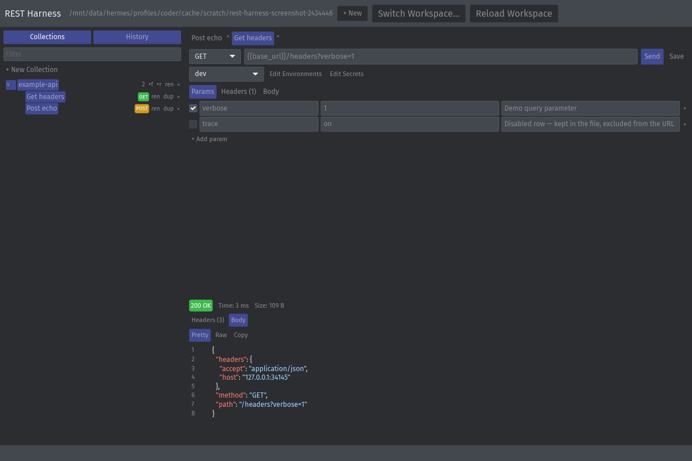

<p align="center">
  
</p>

# REST Harness

A pure-Rust, git-friendly desktop REST API client for Linux and Windows.

[](https://github.com/pizzabeermonkey/rest-harness/actions/workflows/ci.yml)
[](LICENSE)

<p align="center"></p>

## Quick Tour with example-api

The screenshot above is a real render of the app (see below for the headless
mode). It shows the bundled `example-api` sample workspace, driven end to end
through the local echo server:

- **Sidebar (Collections)**: the `example-api` Collection is expanded, listing
  the `Get headers` request (green `GET` badge) and the `Post echo` request
  (amber `POST` badge), with per-row create/rename/delete actions.
- **Top bar**: the open workspace root, plus `+ New`, `Switch Workspace…` and
  `Reload Workspace`. Two tabs are open — `Post echo` and the active
  `Get headers`.
- **Environment**: the `dev` environment of `example-api` is selected. It
  defines `base_url = https://httpbin.org` and an `api_token` variable, so the
  request URL interpolates from `{{base_url}}/headers` to
  `https://httpbin.org/headers?verbose=1`.
- **Request editor**: the `Params` table shows the enabled `verbose=1` demo
  parameter and the disabled `trace=on` row (kept in the file, excluded from
  the URL) — the URL and the table stay in sync two-way.
- **Response inspector**: the real round-trip result — green `200 OK` badge,
  measured `Time` and `Size`, a `Headers (3)` tab and the `Body` tab with the
  `Pretty` view active: line-numbered, syntax-highlighted JSON echoing the
  request headers the local test server received.

> The screenshot is generated by the headless
> `rest-harness --screenshot [output.png]` mode, which drives the real reducer
> against a local echo server and renders the real UI offscreen — no display
> required.

## Overview & Key Features

- **Pure-Rust native desktop GUI** built on [`iced`](https://github.com/iced-rs/iced) with the software `tiny-skia` renderer — no GPU required, builds everywhere.
- **Git-friendly YAML workspace** — `Workspace → Collection → nested Folder → Request`, one human-readable YAML file per artifact. Diff, review, and version your API calls like code.
- **Collection-scoped Environments** with `{{variable}}` interpolation and fail-fast validation: referencing an unknown variable is an error, not a silent empty string.
- **Isolated secrets** — each Collection keeps a gitignored `.secrets.yaml`; secret values are referenced with `{{variable}}` placeholders in request files and are automatically redacted to `***` in the local `.rest-harness-history.yaml` execution log.
- **Two-way live URL ↔ Query Params sync** — edit either side and the other updates instantly, with percent-encoding and disabled-row preservation.
- **Postman-style split-pane Request Composer & Response Inspector** — Pretty JSON syntax highlighting with line numbers, Raw view, and a `Headers (N)` badge.

## Installation

### Prebuilt binaries (recommended)

Download the archive for your platform from the [GitHub Actions build artifacts](https://github.com/pizzabeermonkey/rest-harness/actions/workflows/ci.yml) (every CI run uploads them) or from Releases:

- **Linux x64:** `rest-harness-linux-x86_64.tar.gz`
- **Windows x64:** `rest-harness-windows-x86_64.zip`

```bash
# Linux
tar -xzf rest-harness-linux-x86_64.tar.gz -C rest-harness-dist
./rest-harness-dist/rest-harness
```

```powershell
# Windows
Expand-Archive rest-harness-windows-x86_64.zip -DestinationPath rest-harness-dist
.\rest-harness-dist\rest-harness.exe
```

Each archive contains the binary, `README.md`, `LICENSE`, and the sample `collections/` directory.

### From a local checkout

```bash
cargo install --locked --path .
```

## Building from Source

**Prerequisites:**

- [Rust](https://rustup.rs) stable toolchain
- **Linux:** `pkg-config libxkbcommon-dev libwayland-dev libx11-dev` (e.g. `sudo apt-get install -y pkg-config libxkbcommon-dev libwayland-dev libx11-dev`)
- **Windows:** MSVC Build Tools (installed with the default Visual Studio `x86_64-pc-windows-msvc` toolchain)

**Build & run:**

```bash
# Linux x64
cargo build --release --locked --target x86_64-unknown-linux-gnu
target/x86_64-unknown-linux-gnu/release/rest-harness
```

```powershell
# Windows x64
cargo build --release --locked --target x86_64-pc-windows-msvc
target\x86_64-pc-windows-msvc\release\rest-harness.exe
```

**Run the test suite:**

```bash
cargo test
cargo clippy --all-targets -- -D warnings
cargo fmt --all -- --check
```

## Workspace & File Format Guide

A workspace root is just a directory. REST Harness creates the structure on first
use and keeps everything as plain YAML files:

```text
<workspace root>/
├── .gitignore                    # ignores secrets + local history
├── .rest-harness-history.yaml    # gitignored execution history (auto-redacted)
└── collections/                  # one directory per Collection
    └── example-api/
        ├── .secrets.yaml         # gitignored Collection-local secrets
        ├── environments/         # one flat YAML file per Environment
        │   ├── dev.yaml
        │   └── prod.yaml
        └── <Request name>.yaml   # one YAML file per Request
```

### Example Request (`collections/example-api/get-headers.yaml`)

```yaml
name: Get headers
method: get
url: "{{base_url}}/headers"
params:
  - key: verbose
    value: "1"
    description: Demo query parameter
    enabled: true
  - key: trace
    value: "on"
    description: Disabled row — kept in the file, excluded from the URL
    enabled: false
headers:
  - key: Accept
    value: application/json
    description: ""
    enabled: true
```

Bodies and auth use the same shapes — e.g. a POST with a raw JSON body and a
bearer token referenced (never stored) via a variable:

```yaml
auth: !bearer
  token: "{{api_token}}"
body: !raw
  content_type: json
  content: |
    {
      "message": "Hello from REST Harness"
    }
```

### Example Environment (`environments/dev.yaml`)

Environments are **flat** YAML mappings — the file name is the Environment's
name. The sample collection also ships a `prod.yaml` with a different
`base_url`, so the same requests can be switched between environments.

```yaml
base_url: https://httpbin.org
api_token: local-dev-token
```

### Example `.secrets.yaml`

Secret values live only in this gitignored, Collection-local file: flat
top-level keys are shared across all Environments, and the `environments:`
mapping holds per-Environment overrides. Request files only ever reference them
by `{{variable}}` name.

```yaml
api_token: replace-with-your-local-secret
secrets:
  another_key: placeholder-value
environments:
  prod:
    api_token: replace-with-prod-secret
```

---

Licensed under the [MIT License](LICENSE).
